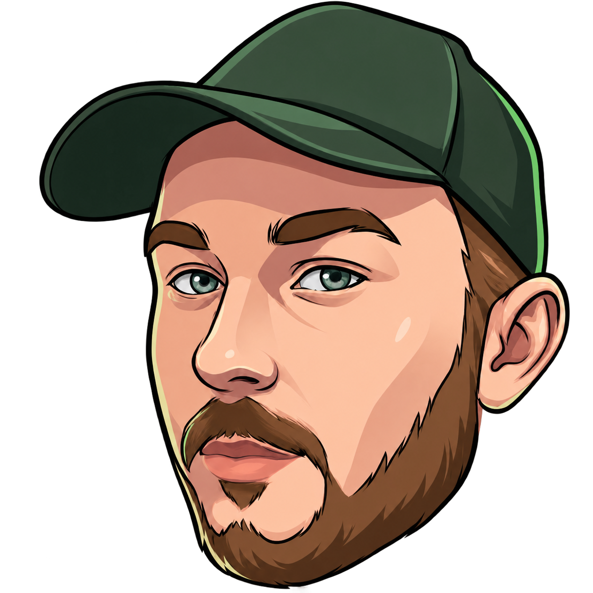
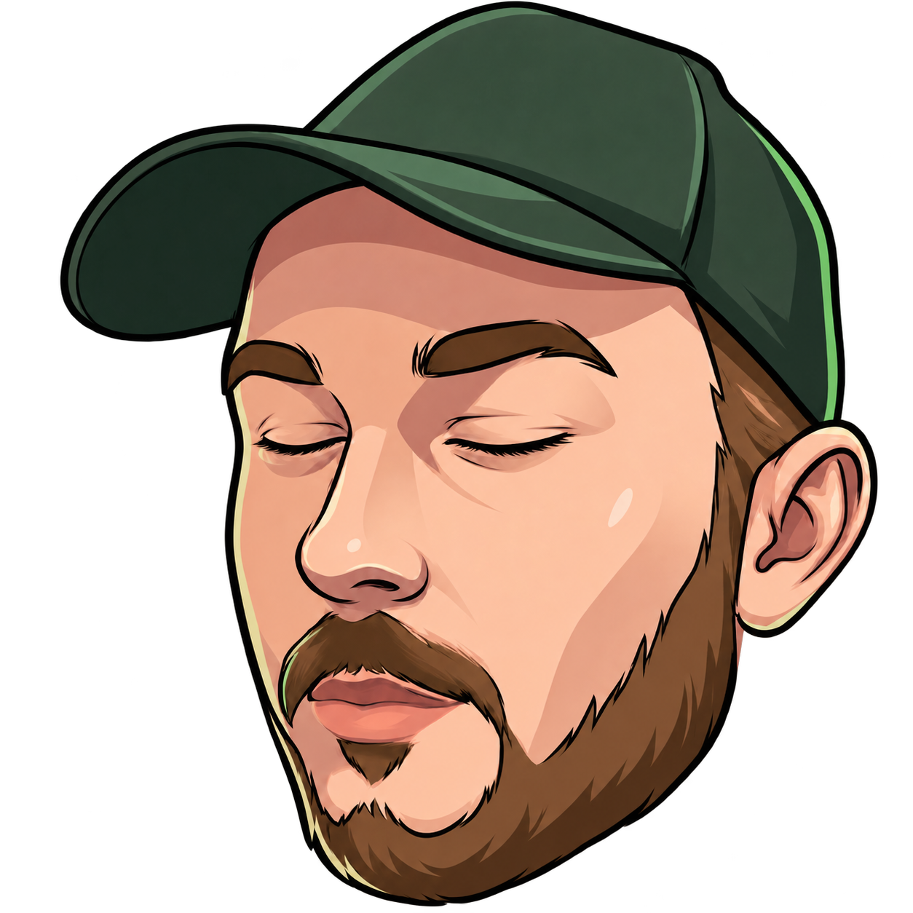
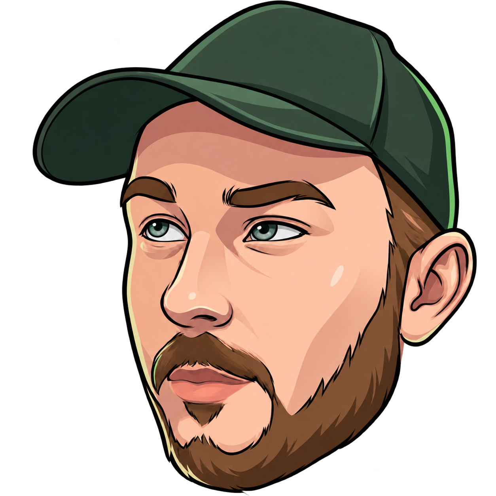
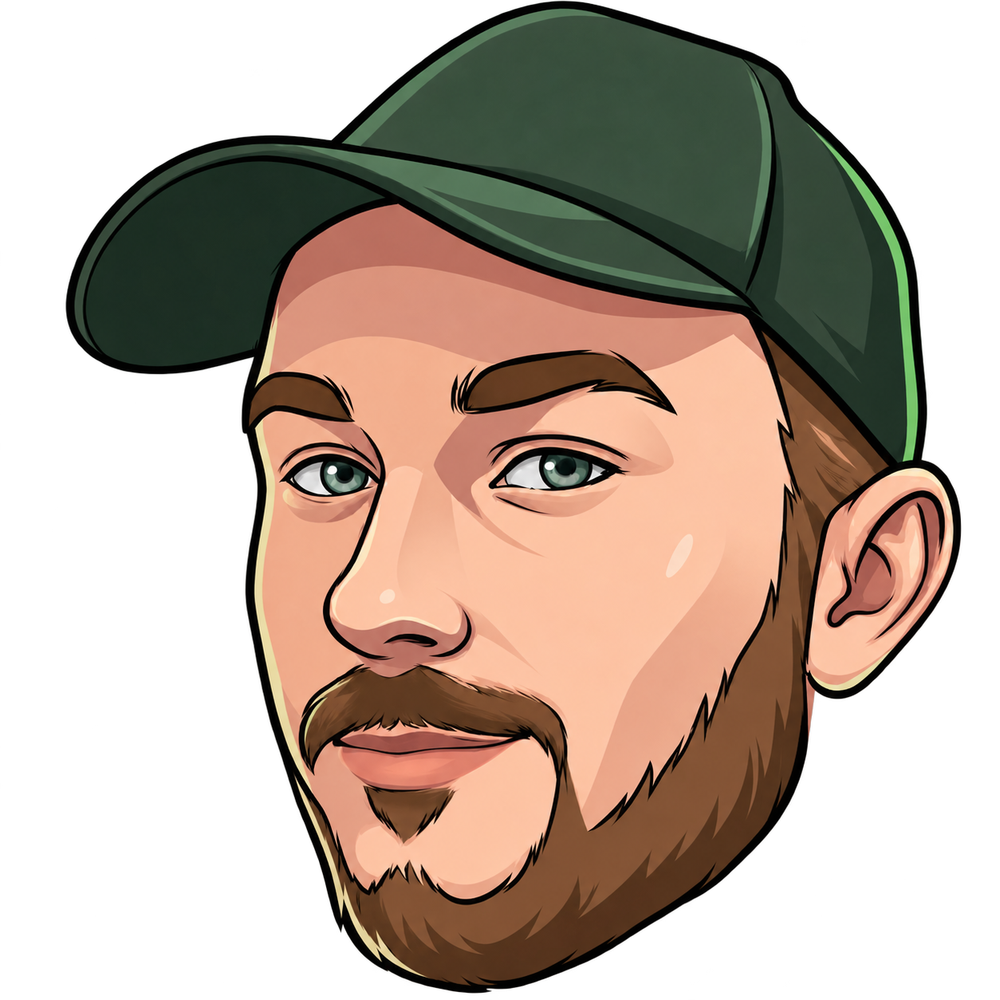
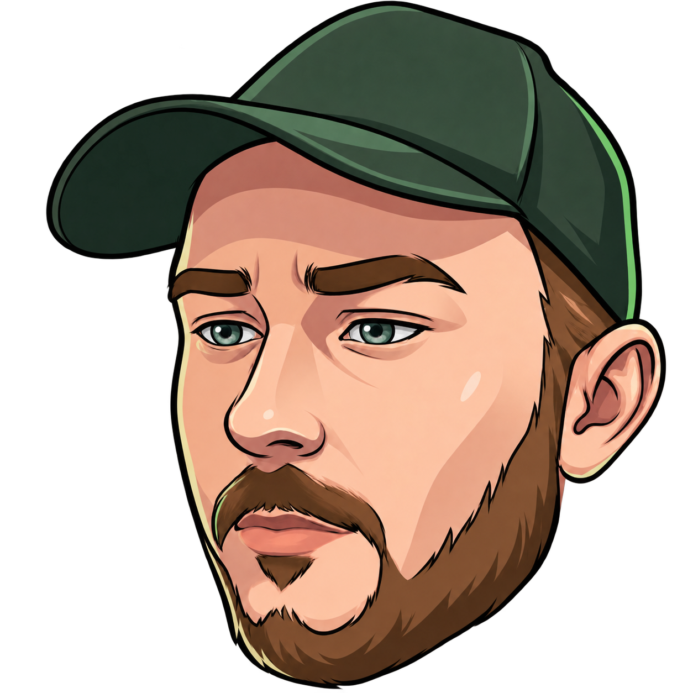

# Kamil Live — expression artwork

These are candidate runtime assets derived from the existing user-supplied `Lasero.App/Assets/LaseroAvatar.png`. The canonical identity is retained: adult human face, forest-green cap, teal eyes, brown brows and beard. All assets have the same 1254 × 1254 transparent RGBA canvas and the same intended alignment. No third-party stock artwork, online asset dependency or NuGet package was used.

| File | Intended state | Art status |
| --- | --- | --- |
| `kamil-neutral.png` | Idle, Attentive, Responding fallback | Exact byte copy of canonical source. |
| `kamil-blink.png` | Blink | Full eyelid closure; visually closest variant. |
| `kamil-thinking.png` | Thinking | Eyes glance up and to one side; brows change slightly. |
| `kamil-happy.png` | Happy | Reserved closed-mouth smile. |
| `kamil-error.png` | Error | Restrained concern in brows and mouth. |

## Preview at UI sizes

The first column approximates the floating 32–48 DIP assistant; the second approximates an expanded-chat 72 DIP hero. Actual WPF appearance must still be checked at 100%, 125%, 150% and 200% Windows scaling, on light and dark themes.

| Expression | 32 px | 48 px | 72 px |
| --- | --- | --- | --- |
| Neutral |  |  |  |
| Blink |  |  |  |
| Thinking |  |  |  |
| Happy |  |  |  |
| Error |  |  |  |

## Integration guidance and limitations

- These are complete image frames, **not** independently riggable layered source art. Image generation cannot reliably provide perfectly registered eye, mouth and cap layers. Do not describe this set as a true skeletal/2.5D rig.
- Keep `kamil-neutral.png` as the universal static fallback. When reduced motion is on, show one still without blink or breathing.
- Blink can use a fast neutral → blink → neutral sequence. Expression changes should use short, restrained fades only after visual review; generated variants slightly repaint more than the intended eye/mouth region. A long crossfade can reveal ghosting around facial details.
- At 28–32 DIP the individual eye and mouth changes are subtle. State text and ordinary loading/error feedback should still communicate status; do not rely on facial expression alone.
- Do not animate the head continuously to simulate life. Irregular short blinks and very small state-specific movement are enough. Suspend all animation when hidden or minimized.
- Record author/usage rights for the canonical user-supplied original before a commercial release. This document does not establish legal provenance.
- The exploratory sculpted concept in `C:\Users\Ruzovka\Documents\Codex\2026-09-30\cont\kamil-proposal\kamil-character-concept.png` is **not** one of these runtime assets and should not replace the canonical portrait without separate identity approval.
